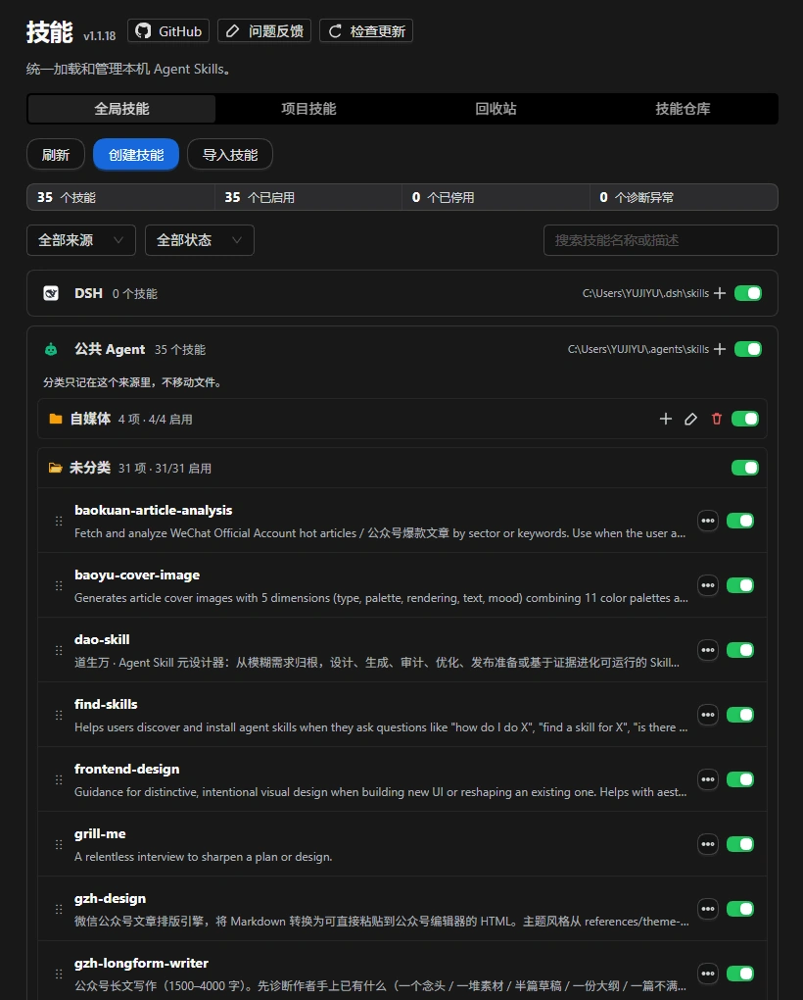
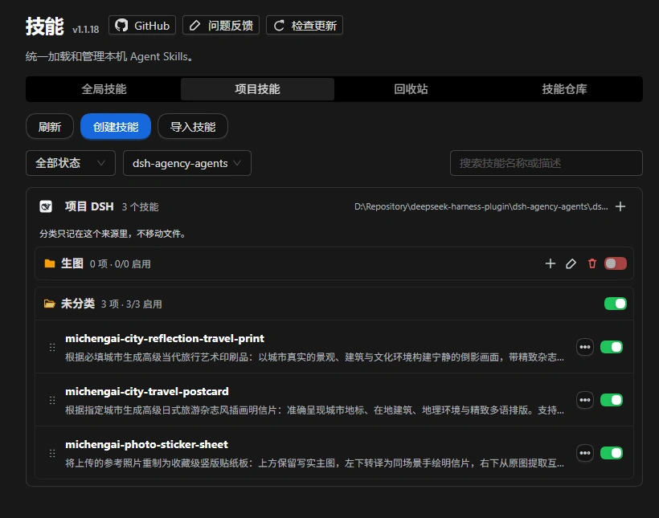
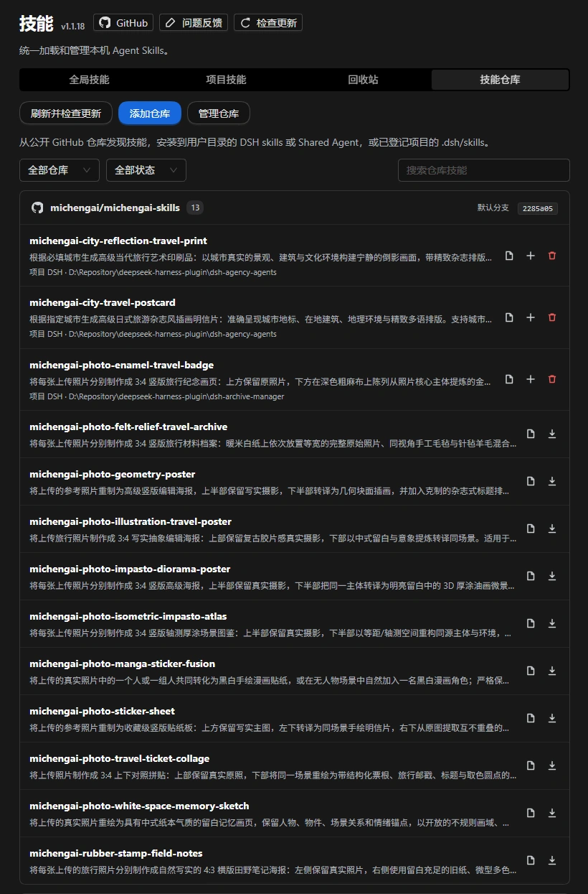

<p align="center">
  
</p>

<div align="center">

# DSH Skills Manager

  **Manage local and project skills, install from GitHub, preview updates and restore backups**

  [简体中文](README.zh-CN.md) · [Changelog](CHANGELOG.md) · [Apache-2.0](LICENSE)

  [](LICENSE)
  [](https://www.npmjs.com/package/@michengai/dsh-skills-manager)
  [](https://www.npmjs.com/package/@michengai/dsh-skills-manager)
  [](https://github.com/MichengAI/dsh-skills-manager)
  [](#installation)
</div>

> DSH Skills Manager is a community-maintained DeepSeek Harness (DSH) plugin, not an official DeepSeek AI product.

This README describes **1.1.16**. Released changes are in the [changelog](CHANGELOG.md).

## Features


Bring skills from your computer and projects into DSH without switching between Agent folders.

- **Manage in one place**: browse collapsible source groups, search, read, and toggle skills. Categories group skills inside a source and do not move files.
- **Global and project skills**: select a registered workspace from the project tab dropdown. Its skills use the same source-group layout as global skills. Project copies take priority over global copies.
- **Reuse existing skills**: supports Codex, Claude Code, Copilot, and other agents without modifying their source files when toggled.
- **Create and import**: create a skill or import ZIP archives, folders, and `SKILL.md` files into your user directory (default) or a registered workspace. User-level writes can go to DSH skills or Shared Agent.
- **Skill repositories**: discover public GitHub skills, install without overwriting local files, review updates and restore backups.
- **Recover deleted skills**: DSH skills go to Trash first, so accidental deletions can be restored.

- **Source tracking and updates**: distinguish local and repository skills, preview file changes, protect local edits, and confirm backup, update or rollback.

## Screenshots

Global skills:



Project skills:



Skill repositories:



*Screenshots show the 1.1.18 release featuring global skills, project skills, and skill repositories. Screenshots show only the core feature panels, with background whitespace and unneeded window chrome cropped out, and use lossless WebP.*

## Installation

Requires a working DeepSeek Harness installation. The commands below use the `web` profile; replace it with yours if needed.

Supported plugin installation sources are the npm registry, a locally built `.tgz` package, and GitHub. GitHub and npm both include a ready-to-run `lib`. After changing source, run the build before committing.

### Ask an agent to install it

Send this to an agent that can use your local terminal:

```text
Install the latest @michengai/dsh-skills-manager into my DSH web profile using the official npm registry. Confirm installation and explain how to reload DSH.
```

### Install manually

```powershell
[Console]::OutputEncoding = [System.Text.Encoding]::UTF8
$OutputEncoding = [System.Text.Encoding]::UTF8
dsh plugin --profile web add @michengai/dsh-skills-manager@latest --registry=https://registry.npmjs.org/
```

Restart DSH, refresh the page, and open **Settings → Skills**. To update, select **Check for updates** or run the installation command again.

- Plugin `1.1.19` is tested with DeepSeek Harness `0.1.2-rc.1`, `0.1.5-rc.1`, `0.1.5-rc.2`, `0.1.5-rc.3`, `0.1.7-rc.1`, `0.1.7-rc.2`, `0.2.0-rc.1`, `0.2.0-rc.2`, `0.2.1-alpha.2`, `0.2.1-alpha.3`.

## Usage

| What you want to do | How |
| --- | --- |
| Find a skill | Choose Global or Project, expand a source group, or use search and filters. |
| Read its contents | Select **View details** for the skill body and source information. |
| Enable or disable | Toggle the skill switch. This affects DSH without editing source files. |
| Add a skill | Select **Create skill** or **Import skill**, then use the side-by-side dropdowns: choose **User directory** (default) or **Specific workspace** on the left, and a location or registered workspace on the right. Check the destination path below. A workspace copy is written to that project's `.dsh/skills` and may be committed to its repository. |
| Install from a repository | Open **Repositories → Add repository**, enter a public GitHub URL, scan, click **Install**, use the same side-by-side dropdowns to choose the scope and location or workspace, check the destination path below, and confirm. |
| Uninstall a repository skill | Click the red **Uninstall** button and confirm. This includes copies in a registered workspace. The installed folder and local edits move to **Trash**, and **Install** becomes available again. |
| Update repository skills | Select **Refresh & check updates**, then **Review update** to inspect changes and confirm backup and update. |
| Roll back an update | Select **Restore previous version** for a skill with a backup, preview and confirm. |
| Recover a deletion | Open **Trash** and restore. |

- **Registered workspaces**: select a registered workspace from the project tab dropdown. Only that workspace is scanned, displayed and searched. Git repositories use the nearest Git root; other folders use the workspace directory, so no `git init` is required. Empty workspaces remain selectable; unavailable directories are disabled.
- **Independent copies**: disabling a project copy allows another enabled copy to take over, and the panel identifies the active source. Disable all copies to turn the skill off completely.
- **File management**: DSH skills can move to Trash from the general manager. Repository-installed copies in DSH, Shared Agent, or a registered workspace can also be uninstalled from **Repositories**. Codex, Claude and other external skills remain read-only. Creation, file import and repository install can write to DSH skills or Shared Agent in your user directory, or to a registered workspace's `.dsh/skills`. Creation, import and installation never preselect a workspace, and Shared Agent is not available for workspaces. The project tab viewing selection is not a write destination.
- **Restore**: retired repository provenance belongs to the specific Trash entry and is reactivated only by an explicit restore, including the destination and update/rollback history. A different same-name skill does not inherit repository management. Uninstalling a Shared Agent copy affects every agent using that directory.

### Repository boundaries

- The header **Check for updates** updates the plugin itself. Repository **Refresh & check updates** checks skill contents without installing or replacing them; it shows animation, counts and the current repository.
- Repository installation writes to user-level DSH skills or Shared Agent (`~/.agents/skills`, overridable with `DSH_AGENTS_HOME`), or to a registered workspace's `<project>/.dsh/skills`. The chooser shows the configured path and disables unsafe paths; a missing directory is created only after confirmation. Codex, Claude and other agent directories cannot be selected. Arbitrary paths, unregistered project destinations and plugin-managed caches are not writable. Missing destinations in legacy records default to DSH; updates and rollback follow the recorded destination. Public GitHub repositories are supported; private credentials and automatic updates are not. Removing a subscription keeps installed skills.
- Archives are limited to 32 MiB, including when filtering by subdirectory. Failed scans preserve the previous catalog; corrupt caches require refresh.
- Local edits require explicit confirmation before replacement. Historical backups are not automatically cleaned and consume additional disk space.

## Supported Agent directories

`~` means your home directory; `<project>` is the project root of a registered workspace. These are default paths; configured DSH directory variables take precedence.

| Source | Global directory | Project directory |
| --- | --- | --- |
|  DSH | `~/.dsh/skills` | `<project>/.dsh/skills` |
|  Shared Agent | `~/.agents/skills` | `<project>/.agents/skills` |
|  CC Switch | `~/.cc-switch/skills` | — |
|  Codex | `~/.codex/skills` | `<project>/.codex/skills` |
|  Claude Code | `~/.claude/skills` | `<project>/.claude/skills` |
|  Gemini | `~/.gemini/skills` | `<project>/.gemini/skills` |
|  OpenCode | `~/.config/opencode/skills` | `<project>/.opencode/skills` |
|  Cursor | `~/.cursor/skills` | `<project>/.cursor/skills` |
|  Copilot | `~/.copilot/skills` | `<project>/.github/skills` |
|  Windsurf | `~/.codeium/windsurf/skills`<br>`~/.windsurf/skills` | `<project>/.windsurf/skills` |
|  Trae | `~/.trae/skills` | `<project>/.trae/skills` |
|  Trae CN | `~/.trae-cn/skills` | `<project>/.trae-cn/skills` |
|  OpenClaw / Clawdbot | `~/.openclaw/skills`<br>`~/.clawdbot/skills` | — |
|  Roo | `~/.roo/skills` | `<project>/.roo/skills` |
|  CodeBuddy | `~/.codebuddy/skills` | `<project>/.codebuddy/skills` |
|  WorkBuddy | `~/.workbuddy/skills` | `<project>/.workbuddy/skills` |
|  Qoder | `~/.qoder/skills` | `<project>/.qoder/skills` |
|  Qoder CN CLI | `~/.qoder-cn/skills` | — |
|  Qoder CN | `~/.lingma/skills` | `<project>/.lingma/skills` |

Ordinary project-root `<project>/skills` directories are not scanned, so repository release resources are not exposed as Agent skills. OpenClaw / Clawdbot support is limited to the user-level sources above. Qoder CN CLI project skills use `<project>/.qoder/skills` and appear as Qoder. Qoder CN IDE uses the Lingma directories. Missing external source directories are not shown.

## DSH product ecosystem

For a desktop workbench, download [DSH Codex Desktop](https://github.com/MichengAI/dsh-codex-desktop/releases). Existing [DeepSeek Harness](https://github.com/deepseek-ai/deepseek-harness) installations can add plugins as needed by following each project's README. Below are 11 first-party plugins; consult the corresponding desktop release notes and bundled catalog for what that version includes.

| Plugin | What you can do |
| --- | --- |
| [Codex UI](https://github.com/MichengAI/dsh-codex-ui) | Organize projects and conversations, search tasks, and navigate chat turns |
| [Agency Agents](https://github.com/MichengAI/dsh-agency-agents) | Choose and summon specialists for your task |
| [Skills Manager](https://github.com/MichengAI/dsh-skills-manager) | Manage local and project skills; install, update and roll back repository skills |
| [Archive Manager](https://github.com/MichengAI/dsh-archive-manager) | Search, restore, or clean up archived conversations |
| [IM Connect](https://github.com/MichengAI/dsh-im-connect) | Send tasks and receive replies through messaging platforms |
| [Automation](https://github.com/MichengAI/dsh-automation) | Schedule tasks and review each run |
| [BTW](https://github.com/MichengAI/dsh-btw) | Ask side questions without interrupting the main task |
| [Simplify](https://github.com/MichengAI/dsh-simplify) | Use `/simplify` to improve code within your Git changes |
| [PUA](https://github.com/MichengAI/dsh-pua) | Guide the Agent to try new approaches after failures, investigate causes, and verify results before completion |
| [Code Review](https://github.com/MichengAI/dsh-code-review) | Use `/review` to request an independent Agent code review and receive the report in the current conversation |
| [Codex Pet](https://github.com/MichengAI/dsh-codex-pet) | View conversation notifications and respond to tool approvals and questions through a desktop pet |

## Feedback and contributions

[Open an issue](https://github.com/MichengAI/dsh-skills-manager/issues) for bugs or suggestions. Include your DSH and plugin versions, reproduction steps, and a full screenshot for UI issues.

Source code lives in `src` and uses strict TypeScript while retaining the existing plugin architecture. Run `npm run typecheck` for type checks, `npm run build` to generate runtime files, and `npm run verify` for the full regression and package checks. GitHub and npm both include a ready-to-run `lib`. After changing source, run the build before committing. Packing still checks types and builds the JavaScript files required by the npm package. CI runs full verification on Node.js 22.19.0 and 24, and code changes also trigger the supported-host compatibility matrix. Contributions are welcome.

To test a source checkout, install dependencies using the pinned pnpm version, run `npm run verify`, then run `npm pack`. Install the resulting `.tgz` with `dsh plugin --profile web add <package.tgz>`, restart DSH and refresh the page. Do not use `--ignore-scripts` when packing: it skips the build hook.

## License

[Apache License 2.0](LICENSE)
