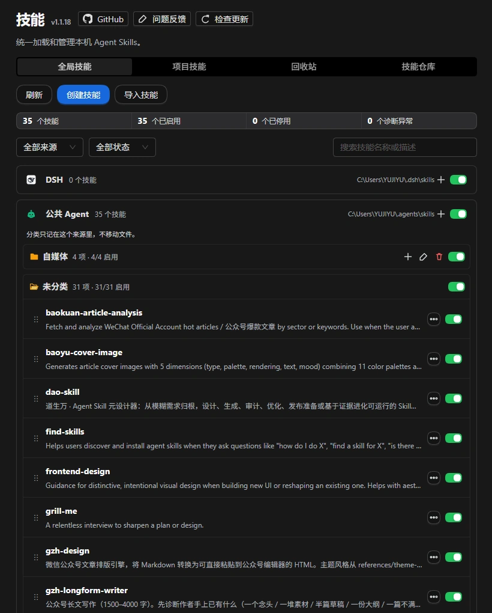

<p align="center">
  
</p>

<div align="center">

# DSH Skills Manager

  **Gerencie skills locais e de projeto de forma unificada, instale do GitHub, visualize atualizações e restaure backups**

  [简体中文](README.zh-CN.md) · [English](README.en.md) · [日本語](README.ja.md) · [Español](README.es.md) · [Français](README.fr.md) · [Deutsch](README.de.md) · [Русский](README.ru.md) · [Português](README.pt.md)

  [Notas de versão](CHANGELOG.md) · [Licença](LICENSE)

  [](LICENSE)
  [](https://www.npmjs.com/package/@michengai/dsh-skills-manager)
  [](https://www.npmjs.com/package/@michengai/dsh-skills-manager)
  [](https://github.com/MichengAI/dsh-skills-manager)
  [](#instalação)
</div>

> DSH Skills Manager é um plugin do DeepSeek Harness (DSH) mantido pela comunidade e não é um produto oficial da DeepSeek AI.

## Funcionalidades

Centralize suas skills locais e de projeto no DSH sem precisar alternar entre pastas de diferentes agentes.

- **Gerenciamento unificado multiview**: Abas de Skills Globais, Skills do Projeto, Descobrir e Lixeira com busca instantânea e filtros de status.
- **Navegação por repositório de origem**: Alterne entre a exibição de pastas e de repositórios com identificação precisa da procedência.
- **Ampla compatibilidade com o ecossistema**: Suporte a mais de 20 ferramentas e ambientes CLI (DSH, Shared Agent, Codex, Claude Code, Copilot, Cursor, Google Antigravity, Windsurf, Qoder, Trae).
- **Categorização e arrastar e soltar**: Crie pastas de categorias, organize skills arrastando (`⋮⋮`) e ative/desative categorias inteiras com um único interruptor.
- **Mercados públicos e repositórios GitHub**: Central «Descobrir» integrada para explorar ClawHub e skills.sh, ou assinar repositórios GitHub públicos com backups automáticos.
- **Criação e importação flexível**: Crie novas skills ou importe arquivos ZIP, pastas e arquivos `SKILL.md`.
- **Visualização em tela ampla**: Janela modal responsiva de 760px com destaque de sintaxe e cópia do Markdown em um clique.
- **Lixeira e restauração segura**: Skills removidas vão primeiro para a lixeira, permitindo restauração completa a qualquer momento.
- **Pastas de origem personalizadas**: Aponte caminhos de leitura externos sem mover os arquivos.

## Capturas de tela

Visão de gerenciamento de skills globais:



Visão de skills de projeto (por espaço de trabalho):


## Instalação

### Solicitar a um agente para instalar

Em uma conversa do DSH, diga ao agente:

```text
Instale o plugin @michengai/dsh-skills-manager
```

### Instalação manual

Execute no terminal:

```bash
dsh plugin add @michengai/dsh-skills-manager
```

No Windows PowerShell:

```powershell
[Console]::OutputEncoding = [System.Text.Encoding]::UTF8
$OutputEncoding = [System.Text.Encoding]::UTF8
dsh plugin --profile web add @michengai/dsh-skills-manager@latest --registry=https://registry.npmjs.org/
```

Reinicie o DSH, atualize a página e abra **Configurações → Skills**. Para atualizar o plugin, utilize o gerenciador de plugins do host ou execute novamente o comando de instalação.

## Configuração do plugin

O plugin segue as convenções padrão de pacotes DSH:
> **Barra lateral → Plugins → Clique em `Skills Manager`** (`plugins.bundle.config`).

Opções disponíveis:

### 1. Entrada na barra lateral (`sidebarEntry`)
- **Padrão**: Desativado (`false`)
- **Descrição**: Exibe um ícone permanente de **Skills** logo abaixo de **Plugins** na barra lateral primária.
- **Efeito**: Abre o gerenciador em um contêiner centralizado de 960px no espaço de trabalho principal.


## Guia de uso

| Ação | Instrução |
| --- | --- |
| **Buscar skills** | Alterne entre abas Globais e Projeto, expanda/recolha fontes ou use a busca e filtros. |
| **Ver detalhes** | Clique em «Ver detalhes» para ler o arquivo `SKILL.md` no modal de 760px com botão de cópia. |
| **Ativar / Desativar** | Alterne o interruptor na linha da skill; altera apenas a invocação no DSH. |
| **Alterar pasta de origem** | Use o menu ➕ para redirecionar o diretório de leitura de skills externas. |
| **Organizar categorias** | Crie categorias e arraste (`⋮⋮`) para reordenar skills. |
| **Criar e importar** | Use o menu ➕ para criar skills ou importar arquivos ZIP e pastas. |
| **Descobrir e instalar** | Explore a aba Descobrir para acessar ClawHub ou repositórios GitHub. |
| **Atualizar skills** | Visualize as diferenças antes de confirmar uma atualização com backup. |
| **Restaurar versões** | Reverta para versões anteriores utilizando o histórico de backup. |
| **Lixeira** | Restaure ou remova permanentemente skills excluídas. |

### Limites de repositório e instalação

- **Atualização**: A ação «Atualizar» apenas verifica novos conteúdos nos repositórios inscritos. A atualização do plugin em si é feita pelo host.
- **Destinos seguros**: Instalações podem ser feitas nas skills DSH do usuário, no Shared Agent (`~/.agents/skills`) ou no `.dsh/skills` do projeto.
- **Download Git seletivo**: Apenas diretórios com `SKILL.md` são baixados.

## Diretórios de agentes compatíveis

| Agente | Diretório global | Variável de ambiente | Diretório do projeto |
| --- | --- | --- | --- |
| **DeepSeek Harness** | `~/.dsh/skills` | — | `.dsh/skills` |
| **Shared Agent** | `~/.agents/skills` | `DSH_AGENTS_HOME` | `.agents/skills` |
| **Codex** | `~/.codex/skills` | `CODEX_HOME` | `.codex/skills` |
| **Claude Code** | `~/.claude/skills` | `CLAUDE_HOME` | `.claude/skills` |
| **GitHub Copilot** | `~/.copilot/skills` | `COPILOT_HOME` | `.copilot/skills` |
| **Cursor** | `~/.cursor/skills` | `CURSOR_HOME` | `.cursor/skills` |
| **Google Antigravity** | `~/.gemini/skills` | `GEMINI_HOME` | `.gemini/skills` |
| **Windsurf** | `~/.windsurf/skills` | `WINDSURF_HOME` | `.windsurf/skills` |
| **Qoder** | `~/.qoder/skills` | `QODER_HOME` | `.qoder/skills` |
| **Trae** | `~/.trae/skills` | `TRAE_HOME` | `.trae/skills` |

### Fontes personalizadas

Para adicionar um agente ausente na lista, abra o menu ➕ e selecione «Pastas de origem…».

## Ecossistema de produtos DSH

| Plugin | Descrição |
| --- | --- |
| **[dsh-skills-manager](https://github.com/MichengAI/dsh-skills-manager)** | Gerenciamento unificado de skills locais e de projeto com backup e GitHub. |
| **[dsh-im-connect](https://github.com/MichengAI/dsh-im-connect)** | Integração com apps de mensagens (Feishu, DingTalk, WeChat, Telegram, Slack). |
| **[dsh-codex-ui](https://github.com/MichengAI/dsh-codex-ui)** | Tema de interface refinado para o DSH Desktop. |

## Feedback e contribuições

- Relatar problemas: [GitHub Issues](https://github.com/MichengAI/dsh-skills-manager/issues)
- Pull requests são bem-vindos.

## Licença

[Apache-2.0](LICENSE) © MichengAI
